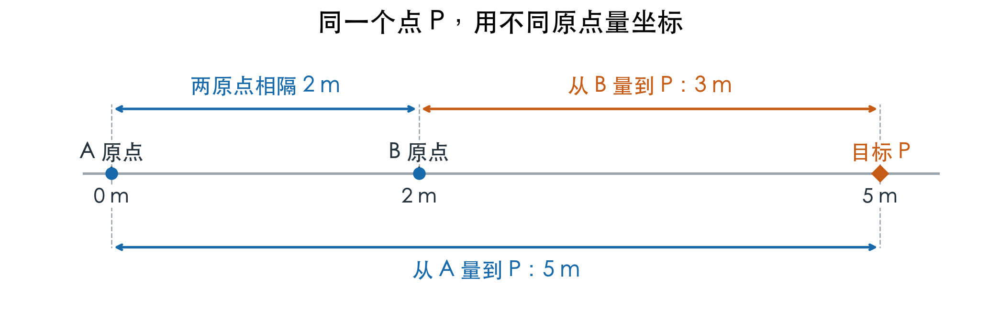
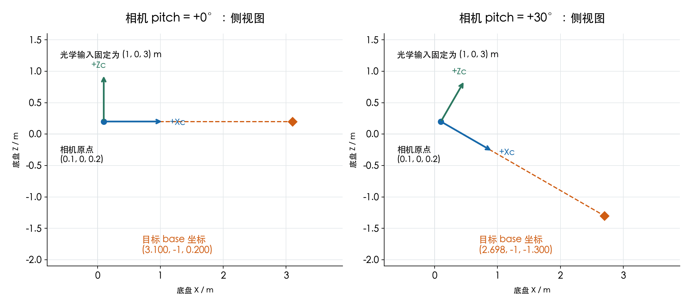
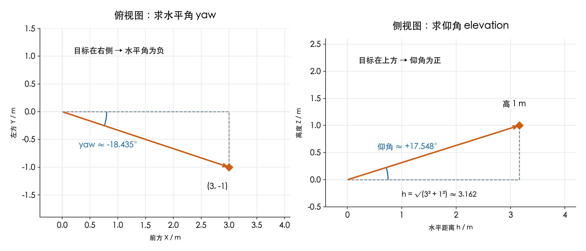

# 机器人学基础：位置、姿态与坐标变换
机器人学研究机器人怎样描述自己的位置和朝向，以及怎样产生需要的运动。底盘在场地中前进、机械臂伸手抓取物体、云台改变指向，都包含这些问题。这份材料先介绍位置和朝向的表示方法，再说明怎样计算不同部件之间的位置关系。后面用云台和底盘举例，看看这些关系怎样用于目标位置换算和角度计算。例题列出了中间结果，可以用配套程序逐项核对。
读前需要的基础：能看懂 `sin`、`cos`、平方根，知道二维向量 `(x,y)` 的含义，能读懂简单的 Python 代码。阅读第 4、7、8 节时，如果已经学过 ROS2 的 `rm_tf_demo` 和 TF2，会更容易理解示例背景；没学过也可以先读数学部分，学过 ROS2 后再运行 TF 示例。
## 1. 机器人学在研究什么
先看一台移动机器人。它要到达场地中的某个位置，需要知道自己在哪里、车头朝哪里，以及下一段准备怎样移动。这些信息要能写成数字，程序才能继续计算。机械臂也会遇到类似的问题：给定几个关节角，夹爪会到哪里？希望夹爪到达某个位置，各关节又应该转多少？这类“关节运动与部件位置之间的关系”，属于运动学。
机器人学还会继续研究完成运动需要多大的力和力矩，以及怎样根据反馈调整电机。可以先把常见问题放在一起看：
| 问题 | 对应内容 |
| --- | --- |
| 一个部件在哪里，朝向如何？ | 位置与姿态的表示。 |
| 关节或轮子转动后，机器人怎样运动？ | 运动学。 |
| 完成这样的运动需要多大的力和力矩？ | 动力学。 |
| 怎样根据当前状态调整电机输出？ | 控制。 |

本文围绕位置与姿态展开，先建立数学表达，再把底盘、云台、相机之间的关系接起来。第 1～6 节是主要内容，第 7 节简要说明时间对应，第 8～9 节提供程序和作业，文末附补充阅读与参考资料。
## 2. 用矩阵描述机器人的位置和朝向
### 2.1 先看位置是相对谁描述的
底盘在场地中的位置告诉我们车在哪里，朝向告诉我们车头指向哪里。这两项合起来称为位姿。相机相对底盘也有自己的位置和朝向，同样可以用位姿描述。
一套三维坐标系需要一个原点和 X、Y、Z 三条坐标轴。先用 W 表示固定在场地上的坐标系，B 表示跟随底盘移动和转动的坐标系。底盘的 X 轴向前，Y 轴向左，Z 轴向上；场地的 Z 轴也向上，X、Y 轴则选定后保持不变。底盘车头朝场地 +X 时，约定 yaw=0。本文距离用 m，程序中的角度用 rad（弧度，π rad = 180°）。[ROS 坐标约定](https://github.com/ros-infrastructure/rep/blob/master/rep-0103.rst)
接下来会用到以下符号。其中 R 叫旋转矩阵，t 叫平移向量，T 叫变换矩阵。表中的 A、B 只是占位符，可以换成任意两套坐标系，例如 W 和 B。R 和 T 的下标可以这样读：前一个字母是结果所在的坐标系，后一个字母是输入所在的坐标系，`R_AB` 就是“从 B 换到 A”。
| 符号 | 可以怎样读 |
| --- | --- |
| `p_A` | 从 A 原点指向目标点的向量，用 A 的坐标轴记录。 |
| `R_AB` | 将 B 中的向量分量换成 A 中的分量。 |
| `t_AB` | B 的原点在 A 中的坐标，即从 A 原点指向 B 原点的位移，用 A 的轴表达。 |
| `T_AB` | 将 R_AB 和 t_AB 放在一起，描述 B 相对 A 的位姿。 |

用大写 P 表示实际空间中的目标点。p_B、p_W 是它在不同坐标系中的坐标，数值可以不同。即使是同一个 P，只要原点或坐标轴方向不同，坐标数值就可能不同。只要知道底盘在场地中的位姿，就能在这两组坐标之间换算。
### 2.2 R 的列与部件朝向有什么关系
把底盘的三条坐标轴放到场地中看，每条轴都能用一个长度为 1 的方向向量（单位向量）表示。把这三个单位向量分别写成一列，再按 X、Y、Z 的顺序并排放好，就得到了 R_WB。例如车头朝向场地 +Y（即 yaw=90°），底盘的竖直轴仍朝上。此时，底盘前方在场地中是 `(0,1,0)`，左方是 `(-1,0,0)`，上方是 `(0,0,1)`。因此：
```text
R_WB = [ 0  -1  0 ]
       [ 1   0  0 ]
       [ 0   0  1 ]
```
可以逐列对照：第一列 `(0,1,0)` 是底盘前方，第二列 `(-1,0,0)` 是底盘左方，第三列 `(0,0,1)` 是底盘上方。目标的底盘坐标 `(x_B,y_B,z_B)` 表示沿底盘三条轴各走多远，负数表示沿该轴的反方向。乘上 R_WB，就是把这三段位移改用场地的轴向来表示。本文计算时都把坐标写成列向量；为方便阅读，正文仍用 `(x,y,z)` 的形式记录数值。
### 2.3 为什么还要加一个 t
先把两套坐标轴的方向设成相同，只看 X 方向。A 的原点在图中的 0 m 处，B 的原点在它右边 2 m 处。目标 P 再往右 3 m：

从 B 原点开始量，P 的 X 坐标是 3 m。从 A 原点开始量，同一个 P 的 X 坐标是 5 m。这两种说法同时成立，因为它们选择了不同的零点。因此，从 B 的读数换成 A 的读数，要把两个零点之间的距离算进去：`x_A=2+3=5 m`。P 始终位于图中的同一处，改变的是我们从哪个原点描述它。回到三维时，可以先看这条几何关系：
```text
从 A 原点到 P = 从 A 原点到 B 原点 + 从 B 原点到 P
```
第一段位移用 A 的轴向记录，就是 t_AB。第二段原先用 B 的轴向记录，坐标是 p_B。如果两套轴向不同，先乘 R_AB，将这段位移改用 A 的轴向记录。两段现在采用相同的轴向，便可以相加：
```text
p_A = R_AB p_B + t_AB
```
所以，R 处理的是两套坐标轴的方向差别，t 处理的是两个原点的位置差别。这个式子将同一个 P 的 B 系坐标换成 A 系坐标。得到 p_A 后，还可以用逆变换求回 p_B，P 的实际位置在整个换算中保持不变。要注意区分两种“加法”：在同一个坐标系里给一个点加上位移，是把点挪到了别处；这里加 t，点没有动，只是换了一个原点来量它。图中的 3 m 和 5 m 说的就是同一个 P。
### 2.4 把 R 和 t 放进同一个 T
机器人上常常需要连续换算几次位置。例如先从相机换到云台，再从云台换到底盘。如果把 R 和 t 合进一个矩阵，连续换算就只是几个矩阵相乘。这个矩阵叫齐次变换矩阵：
```text
T_AB = [ R_AB  t_AB ]
       [ 0ᵀ    1    ]

[p_A; 1] = T_AB [p_B; 1]
```
T 是 4×4 矩阵：左上角是 3×3 的 R，右上角是 t，最后一行 `0ᵀ` 表示三个 0，再加一个 1。`[p_B; 1]` 表示在 p_B 的三个坐标下面再补一个 1，变成四维列向量。补上这个 1 后，矩阵最后一列的平移就能参与乘法。将上式展开，得到的仍然是 `p_A=R_AB p_B+t_AB`。方向向量则可以写成 `[v;0]`。最后一项为 0 时，平移项不会加入结果，因此只换算方向。
### 2.5 怎样反过来计算
已知 p_A，希望求回 p_B，可以分两步：先减去 t_AB，去掉两个原点之间的偏移；再乘 R_ABᵀ，把位移换回 B 的方向。这里的 ᵀ 表示转置，即把矩阵的行、列互换。对于旋转矩阵，转置就表示反向旋转。
```text
p_B = R_ABᵀ (p_A - t_AB)
```
第 3 节可以用一组数字核对这两步。
### 2.6 经过两个部件时，怎样连接计算
再引入两个坐标系：C 表示相机坐标系，G 表示云台坐标系。相机测到的目标位置在相机坐标系中，记为 p_C。我们先算它在云台中的位置，再算它在底盘中的位置：
```text
p_G = R_GC p_C + t_GC
p_B = R_BG p_G + t_BG
```
把第一式代入第二式，就能看出两段关系怎样组合：
```text
p_B = R_BG (R_GC p_C + t_GC) + t_BG
    = (R_BG R_GC) p_C + (R_BG t_GC + t_BG)

T_BC = T_BG T_GC
```
这里的 t_GC 用云台方向表达。要与底盘中的 t_BG 相加，需要先乘 R_BG，把它换成底盘方向。这也是组合平移里会出现 `R_BG t_GC` 的原因。用齐次变换矩阵计算时，要给三维坐标补上一个 1：
```text
[p_B; 1] = T_BG T_GC [p_C; 1]
```
右边的矩阵先作用：先把相机坐标换到云台，再换到底盘。目标点本身没有移动，变化的是描述它的坐标系。[齐次变换资料](https://modernrobotics.northwestern.edu/nu-gm-book-resource/3-3-1-homogeneous-transformation-matrices/)
### 2.7 yaw 和 pitch 的方向怎样约定
yaw（偏航）表示水平转向，pitch（俯仰）表示抬头或低头。它们的正方向都按右手定则确定：右手大拇指指向转轴的正方向，四指弯曲的方向就是正转方向。yaw 绕 +Z 轴转。大拇指朝上，从上往下看四指是逆时针，所以正 yaw 是向左转。pitch 绕 +Y 轴转。大拇指朝左，四指从前方 +X 弯向下方 −Z，所以正 pitch 是低头。
后面求瞄准角时，我们把向上抬的角叫仰角，用 `elevation` 表示。它向上为正，与这里的数学 pitch 正号相反。后文分别用 `pitch_math` 和 `elevation` 表示数学 pitch 和仰角。下面用 θ 表示 yaw、β 表示数学 pitch。绕 Z、Y 轴的旋转矩阵分别为：
```text
Rz(θ) = [ cosθ  -sinθ  0 ]       Ry(β) = [ cosβ  0  sinβ ]
        [ sinθ   cosθ  0 ]               [ 0     1  0    ]
        [ 0      0     1 ]               [-sinβ  0  cosβ ]
```
## 3. 例题：底盘与场地之间的正逆变换
这题只考虑水平面，省去 Z 坐标。底盘原点在场地 `(2,1)` m，车头朝向场地 +Y，即 yaw=90°。目标在底盘前方 3 m、右侧 1 m，因此 p_B=(3,-1)。先将目标位移换成场地方向，再加底盘的位置：
```text
R_WB = [ 0  -1 ]       t_WB = (2,1)
       [ 1   0 ]

R_WB p_B = (0×3 + (-1)×(-1), 1×3 + 0×(-1)) = (1,3)
p_W = (1,3) + (2,1) = (3,4) m
```
中间量 `(1,3)` 表示从底盘原点到目标的位移，已经按场地的方向表达。加上底盘位置后，得到的 `(3,4)` 才是从场地原点描述的目标坐标。接着反过来算。先从目标场地坐标中减去底盘位置，再把方向换回底盘：
```text
p_W - t_WB = (3,4) - (2,1) = (1,3)
R_WBᵀ = [  0  1 ]
        [ -1  0 ]
p_B = R_WBᵀ (1,3) = (0×1 + 1×3, (-1)×1 + 0×3) = (3,-1) m
```
结果回到了原来的 `(3,-1)`。可以在 `code` 目录运行 `robotics_demo.py`，核对正向计算的中间量和逆变换结果；示例中的 `world_to_body` 提供了反向计算的实现。
## 4. 相机、云台和底盘之间的位置换算
### 4.1 先看每一段关系从哪里来
ROS2 的 TF2 用于保存和查询坐标系之间的变换。培训仓库中的 `rm_tf_demo` 使用 `base_link → gimbal_link → camera_link`，分别对应底盘 B、云台 G 和相机 C。箭头表示父子层级，不表示实际的上下位置，也不是坐标换算的方向。计算相机目标的底盘坐标时，要沿相反方向换算：相机→云台→底盘。
示例里，云台原点在底盘上方 0.2 m，云台坐标轴与底盘对齐，所以 G 到 B 只有平移，没有旋转。相机原点在云台 +X 方向 0.1 m 处，相机坐标轴相对 G 绕 Y 轴转过 pitch 角 β。这是一个简化模型：相机原点的位置不随 pitch 改变，只有坐标轴方向改变。如果实际相机原点偏离 pitch 转轴，转动时相机原点的位置也会变化，需要另外计算。示例对应的公式是：
```text
p_G = Ry(β) p_C + (0.1,0,0)
p_B = p_G + (0,0,0.2)

T_BC = T_BG T_GC
```
实际建模时，要区分固定安装关系和关节运动关系。相机相对安装支架的位置和朝向称为安装外参，在安装不变时保持固定；支架随关节转动产生的变换则要用当前关节角更新，这个角度通常来自编码器反馈。类似地，大 yaw 平台与小 yaw 云台之间也可以分段记录位置和朝向，再将目标逐段换到底盘中。第 9.2 节会用这种结构安排进阶作业。 [对应仓库章节：TF2 坐标变换](https://github.com/Venom-Algorithm/training/blob/0f1f330f0cb8685606813139f853e23c84a43bb0/02-ros2-wheelleg/Tutorial/ROS2_%E5%85%A5%E9%97%A8/07_TF2%E5%9D%90%E6%A0%87%E5%8F%98%E6%8D%A2.md)
### 4.2 把一个相机目标换到底盘中
设目标相机坐标为 p_C=(3,-1,0) m，相机 pitch 为 +30°。先用第 2.7 节的 Ry 旋转这段目标位移：
```text
x = cos30° × 3 + sin30° × 0 ≈ 2.598076
y = -1（绕 Y 轴旋转不改变 Y）
z = -sin30° × 3 + cos30° × 0 = -1.5

Ry(30°) p_C = (2.598076,-1,-1.5) m
```
然后加两段安装位置。下面每一行都以上一行结果为起点：
| 计算步骤 | 结果，单位 m |
| --- | --- |
| 相机输入 p_C | `(3,-1,0)` |
| 用 Ry(30°) 旋转位移 | `(2.598076,-1,-1.5)` |
| 加相机原点在云台 +X 方向的偏移 0.1 m，得到 p_G | `(2.698076,-1,-1.5)` |
| 加云台原点在底盘 +Z 方向的偏移 0.2 m，得到 p_B | `(2.698076,-1,-1.3)` |

还可以把相机原点 `(0,0,0)` 作为输入，沿同样步骤计算。结果是 `(0.1,0,0.2)`，与 rm_tf_demo 监听器打印的相机位置一致。这样可以区分两件事：日志里打印的是相机原点在底盘中的位置，相机看到的目标点则是另一个点。

### 4.3 在 TF 程序里找出这些量
`lookup_transform('base_link','camera_link',...)` 中，第一个参数指定结果放在哪个坐标系，第二个参数指定输入点来自哪里。这个调用返回 T_BC，可以把相机中的点换到底盘中。
TF 用四元数 `(x,y,z,w)` 这四个数保存旋转，它们不是目标点的坐标。配套程序用四元数旋转函数完成计算，这里暂不展开四元数的原理。位置换算仍按前面的步骤进行：先旋转目标位移，再加平移 t。
## 5. 相机使用的坐标轴怎样与前面对应
### 5.1 先对照同一个物理方向
前面使用的相机坐标 C 采用 X 前、Y 左、Z 上。相机数据还常使用另一套轴：X 右、Y 下、Z 前，称为光学坐标系，这里记为 O。图像处理和相机标定通常用这套轴，因为它和图像像素的排列方向一致：像素列号向右增大，行号向下增大。为了区分，下面把前面那套与底盘约定相同的 C 称为机体式相机坐标。先让两套坐标系的原点重合，并让相机正前方对准 C 的前方。此时，同一个物理方向在两套坐标中有以下对应关系：
| 物理方向 | 光学坐标 O | 机体式相机坐标 C |
| --- | --- | --- |
| 前方 | +Z | +X |
| 右方 | +X | −Y |
| 下方 | +Y | −Z |

例如光学 X=1 表示右侧 1 m，换到 C 中要写成 Y=-1。按同样的方法对照另外两条轴，得到：
```text
x_C = z_O
y_C = -x_O
z_C = -y_O
```
写成矩阵后，这一步也能接到前面的变换公式中：
```text
R_CO = [ 0   0   1 ]
       [-1   0   0 ]       p_C = R_CO p_O
       [ 0  -1   0 ]
```
两套原点重合，所以平移为零。可以再按列读一次 R_CO：三列分别表示光学 X、Y、Z 轴在 C 中的方向，也就是右、下、前。用上表检查，依次应为 −Y、−Z、+X。
### 5.2 用两个点检查符号
给定 p_O=(1,0,3) m，目标位于右侧 1 m、前方 3 m。换到 C 中，应得到 `(3,-1,0)`。这里输入的都是以 m 为单位的三维坐标，不是图像中的像素坐标。只有像素位置、没有深度或其他几何信息时，不能直接用这套公式得到三维位置。再看 p_O=(0.2,0.5,2) m。它位于右侧 0.2 m、下方 0.5 m、前方 2 m，换算结果为 `(2,-0.2,-0.5)`。写程序时，可以用这种“右、下、前”的直观判断，检查正负号有没有写反。
### 5.3 接到第 4 节的计算中
现在从光学坐标 `(1,0,3)` 出发。先用 R_CO 换到 C，再使用第 4 节给出的相机和云台关系。相机 pitch 仍取 +30°：
| 到了哪一步 | 目标坐标，单位 m |
| --- | --- |
| 光学输入 p_O | `(1,0,3)` |
| 换轴后得到 p_C | `(3,-1,0)` |
| 相机到云台，得到 p_G | `(2.698076,-1,-1.5)` |
| 云台到底盘，得到 p_B | `(2.698076,-1,-1.3)` |

这张表把第 4、5 节接在了一起。写程序时可以逐行输出，检查每次计算是否与对应的那一段关系一致。
## 6. 从目标位置求云台角度
### 6.1 角度从哪里开始量
云台角度为零时，总会对应一个约定的朝向，我们把它称为零位。为了计算目标角，先在云台安装座上固定一套坐标轴：X 指向零位前方，Y 向左，Z 向上。云台转动时，这套参考轴相对安装座保持不变，不跟着 yaw、pitch 关节一起转。这道例题假设 yaw、pitch 两根转轴相交，并将交点作为原点。实际云台的两轴之间常有一小段偏移，这里先忽略。
第 5 节得到的是目标的底盘坐标。求云台角度前，先把它换到云台零位参考系。若这套参考系与底盘的轴向相同，从目标底盘坐标中减去转轴交点的底盘坐标即可；若轴向也不同，就按第 2.5 节先减平移，再做反向旋转。
下面另取一个已经换算到该参考系中的目标，坐标为 `(3,-1,1)` m，不沿用第 5 节的数值。它位于前方、右侧、上方，因此应该向右转、向上抬。按向左为正的 yaw、向上为正的仰角约定，两个结果应分别为负、正。
### 6.2 水平角 yaw
先看俯视图。云台零位时 +X 指向正前方，所以目标在水平面内的方向与 +X 的夹角，就是从零位量起的 yaw。目标在这里是 `(x,y)=(3,-1)`。这里不用 `atan(y/x)`，因为它分不清 `(1,1)` 和 `(-1,-1)`，x=0 时还会除以零。`atan2(y,x)` 分别接收 y 和 x，能根据两者的正负判断目标在哪个象限，返回 −π 到 π 之间的角：
```text
yaw = atan2(-1,3)
    ≈ -0.321751 rad
    ≈ -18.434949°
```
负号对应向右转，与刚才的方向判断一致。
### 6.3 向上抬的角度
仰角要用到目标高度 z，以及它在水平面上离原点多远。先由 x、y 求出这段水平距离 h，再用高度和 h 求角：
```text
h = sqrt(x² + y²) = sqrt(10) ≈ 3.162278 m
elevation = atan2(z,h)
          ≈ 0.306277 rad
          ≈ 17.548401°
```
这里 z=1 m，所以仰角为正。h 已经把前后和左右距离合在一起了。想象一个同时经过原点和目标的竖直平面：h 是直角三角形的水平边，z 是竖直边，原点到目标的连线是斜边，仰角就是这条连线与水平边的夹角。

### 6.4 对应的 Python 计算
```python
import math

point_x = 3.0      # 前方 3 m
point_y = -1.0     # 右侧 1 m
point_z = 1.0      # 上方 1 m

yaw_rad = math.atan2(point_y, point_x)

# hypot(x,y) 计算 sqrt(x*x+y*y)。
horizontal_distance = math.hypot(point_x, point_y)
elevation_rad = math.atan2(point_z, horizontal_distance)

print(math.degrees(yaw_rad))         # 约 -18.434949
print(math.degrees(elevation_rad))   # 约 17.548401
```
算出的两个角都以 rad 计，显示时再转成度。练习函数 `aim_angles` 就是实现这段计算。
### 6.5 云台已经转过以后，目标角怎样算
再做一个水平转向的例子。这次让相机原点与云台转轴重合，pitch=0，并假设云台零位时相机的 X、Y 轴与参考轴对齐。这样就没有安装偏移和额外的安装转角，只需处理当前 yaw。云台已经从零位向左转了 30°，相机也跟着转了 30°。
此时相机报告目标位于前方 3 m、右侧 1 m，即 `(3,-1)`。相对当前相机方向，目标偏右约 18.435°。要算从零位量起的目标角，还需要把云台已经转过的 30°接进去。先将目标位置从当前相机方向换到固定参考轴，也就是乘 Rz(30°)：
```text
x = cos30° × 3 - sin30° × (-1) ≈ 3.098076
y = sin30° × 3 + cos30° × (-1) ≈ 0.633975

yaw_target = atan2(y,x) ≈ +11.565°
```
因此，−18.435°表示目标相对当前相机的偏差，+11.565°表示目标相对云台零位的方向。读角度数据时，也要像读位置一样，先确认它以什么方向为起点。
### 6.6 将几何角写成电控使用的角度
前面的几何计算已经约定了正方向。电机编码器有自己的零点和读数方向，发送目标角时，要把两套约定接起来。先找到几何角为零时对应的编码器读数，记作 `zero_offset`。再看编码器的正方向与几何角是否一致：一致时 `direction_sign=1`，相反时取 −1。这里假设电控接口使用 rad，且角度已经按关节输出端计量，不需要再换算减速比或编码器计数。于是：
```text
command_angle = direction_sign × geometric_angle + zero_offset
```
例如几何 yaw 为 +0.3 rad，编码器向右转时读数增大，几何零位对应编码器 +0.2 rad。几何 yaw 向左为正，编码器向右为正，两者相反，所以 direction_sign=-1，发送的目标角就是 `-0.3+0.2=-0.1 rad`。仰角还要对照 pitch 的轴向。第 2 节的数学 pitch 向下为正，因此 `pitch_math=-elevation`。本例仰角 +17.548°对应数学 pitch −17.548°，再按对应电机的零点和方向换算。
### 6.7 目标正好在上方时
若目标为 `(0,0,1)`，它的水平距离为零。在这个理想几何模型中，无论 yaw 取什么值，目标都在正上方，所以 yaw 没有唯一解；不能用 atan2(0,0) 的返回值判断目标的水平方向。练习中约定水平距离小于等于 `1e-12 m`（即 10⁻¹² m，小到可以认为就是 0）时抛出 `ValueError`。输入含 NaN（不是有效数值）或正负无穷时，也抛出 `ValueError`，即用 Python 异常表示输入不适合计算。这样调用这个函数的程序就可以统一处理异常数据。
## 7. 目标位置和云台姿态要取同一时刻
目标位置对应的是传感器采集数据的时刻。处理数据期间，云台可能已经转到了别的角度。例如采集时 yaw=20°，经过 50 ms，云台以 100°/s 又转了 5°。换算这次采集到的目标位置，应使用当时的 20°。因此，要保留采集时间戳，并查询同一时刻的 TF。`rclpy.time.Time()` 查询的是最新可用变换；处理传感器消息时，应将消息的 `header.stamp` 转成 `Time` 后用于查询。[ROS 2 Humble Buffer API](https://github.com/ros2/geometry2/blob/humble/tf2_ros_py/tf2_ros/buffer.py)
## 8. 运行配套程序
### 8.1 先对照数学例题
本讲代码位于 [GitHub 代码目录](https://github.com/Venom-Algorithm/training/tree/main/03-robotics-basics/code)。先同步自己的 Fork，再进入本地代码目录。下方命令沿用克隆位置 `~/venom_cpp_basics/training`，请按自己的保存位置调整。
```bash
cd ~/venom_cpp_basics/training/03-robotics-basics/code
python3 robotics_demo.py --pitch-deg 30
```
程序分步输出底盘到场地的位置换算、相机目标到底盘的位置换算，以及目标角度。对照第 3～6 节的例题，检查每个中间量。再运行 `python3 robotics_demo.py --pitch-deg -30`，观察目标高度怎样变化。
### 8.2 让 TF 广播器提供当前姿态
打开两个终端。终端 A 运行前面工作区里的 TF 广播器，终端 B 用它广播的数据计算目标位置。工作区路径按自己的克隆位置调整。
```bash
# 终端 A
conda activate rm_ros2
source /opt/ros/humble/setup.bash
cd ~/venom_cpp_basics/training/02-ros2-wheelleg/Tutorial/ros2_ws
source install/setup.bash
ros2 run rm_tf_demo tf_broadcaster
```
```bash
# 终端 B
conda activate rm_ros2
source /opt/ros/humble/setup.bash
source ~/venom_cpp_basics/training/02-ros2-wheelleg/Tutorial/ros2_ws/install/setup.bash
cd ~/venom_cpp_basics/training/03-robotics-basics/code
python3 tf_target_demo.py
```
脚本先查询相机到底盘的变换，再构造光学目标 `(1,0,3)`。换轴后得到 `(3,-1,0)`，接着使用查询到的旋转和平移，求目标的底盘坐标。输出中，相机原点在底盘中的坐标应保持 `(0.1,0,0.2)`，与第 4 节的简化模型一致。目标的底盘 X、Z 会随着 pitch 变化，Y 保持 −1 m。
注意，脚本每次都使用相同的光学坐标 `(1,0,3)` 作为测试输入，并不是在跟踪同一个固定在场地中的目标。因此，相机朝向改变后，换算出的底盘坐标也会改变。对于实际静止目标，相机转动时，传感器测得的目标相机坐标通常也会变化。
## 9. 基础作业与进阶作业
### 9.1 基础作业
完成 [exercise.py](https://github.com/Venom-Algorithm/training/blob/main/03-robotics-basics/code/exercise.py) 中的坐标换轴和角度计算，对应第 5、6 节。按[作业说明](https://github.com/Venom-Algorithm/training/blob/main/03-robotics-basics/%E4%BD%9C%E4%B8%9A%E8%AF%B4%E6%98%8E.md)中的调用示例运行自己的函数，对照参考输出和目标的实际方向，检查换轴与角度符号是否正确。
### 9.2 进阶：大小 yaw 的位置换算
一些 RoboMaster 哨兵使用大 yaw 平台承载小 yaw 云台，小 yaw 可以安装在大平台的两侧。[ACE 战队技术报告第 2.1 节](https://bbs-web-static.robomaster.com/0b4f7e1b7bf34a0b88556bc0e9d8d2751752679631639/ACE%20RM2025%E5%93%A8%E5%85%B5%E6%8A%80%E6%9C%AF%E6%96%87%E6%A1%A3.pdf)介绍了这样的结构。本题取其中一侧，使用两根竖直 yaw 轴的水平转向模型，尺寸采用练习参数。
用 B 表示底盘，L 表示大 yaw 平台，S 表示小 yaw。大 yaw 角相对底盘测量，小 yaw 角相对大 yaw 平台测量，两段角度都向左为正。各关节角为零时，对应的子坐标系与父坐标系轴向对齐。目标坐标已按小 yaw 的 X 前、Y 左、Z 上表达。先把目标从 S 换到 L，再换到 B。每一段都先旋转水平分量，再加该段安装位置：
```text
p_L = Rz(small_yaw) p_S + small_offset
p_B = Rz(big_yaw) p_L + big_offset
```
`small_offset` 是小 yaw 原点在大 yaw 平台 L 中的坐标，用 L 的轴表达；`big_offset` 是大 yaw 原点在底盘 B 中的坐标，用 B 的轴表达。两根轴的位置可以不同，因此要分别处理这两段偏移。配套示例取大 yaw 为 +90°、小 yaw 为 −90°，逐步输出位置换算结果：
```bash
python3 big_small_yaw_demo.py
```
进阶作业完成 `exercise.py` 中的 `small_yaw_to_base`。运行自己的函数，与示例的中间量和最终坐标核对；再将两段角度与偏移设为零，观察返回值是否回到输入坐标。具体调用和自评方法见[作业说明](https://github.com/Venom-Algorithm/training/blob/main/03-robotics-basics/%E4%BD%9C%E4%B8%9A%E8%AF%B4%E6%98%8E.md)。
基础为必做，进阶为选做。完成后将 `exercise.py` 提交并推送到自己的 Fork，确认页面中的代码已更新，本次任务即完成。
## 补充阅读（选读）
### 旋转矩阵的两个检查
旋转不会改变长度和夹角，所以旋转矩阵满足 `RᵀR=I`。其中 Rᵀ 是 R 的转置（行列互换），I 是单位矩阵（对角线为 1、其余为 0）。此外，旋转矩阵满足 `det(R)=1`。如果一个矩阵满足前一条件，但行列式 det 等于 −1，说明它还包含镜像翻转。编程时可以用这两个性质检查 R 有没有写错。
### 参考资料
| 资料 | 读本文哪一部分时查阅 |
| --- | --- |
| [Venom 培训仓库](https://github.com/Venom-Algorithm/training) | 对照已学的 ROS2、TF2 与轮腿示例。 |
| [ROS REP-103](https://github.com/ros-infrastructure/rep/blob/master/rep-0103.rst) | 坐标轴、右手约定、单位。 |
| [Modern Robotics：旋转矩阵](https://modernrobotics.northwestern.edu/nu-gm-book-resource/3-2-1-rotation-matrices-part-1-of-2/) | 从坐标轴方向理解旋转矩阵。 |
| [Modern Robotics：齐次变换](https://modernrobotics.northwestern.edu/nu-gm-book-resource/3-3-1-homogeneous-transformation-matrices/) | 旋转、平移与多段变换。 |
